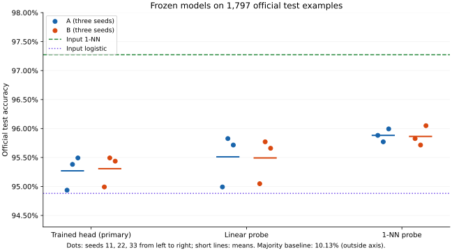

# Separation Index Representation Audit

A CPU study of when label-based Separation Index (SI) agrees with held-out classification performance, and when it fails to distinguish learned representations.

The project studies Optdigits MLPs and Fashion-MNIST CNNs with fixed baselines, paired seeds, frozen evaluation rules and explicitly reported negative results. It implements a published SI definition; it does not claim a new index or a state-of-the-art classifier.

## Main results

| Dataset | Fixed comparison | Test accuracy |
|---|---|---:|
| Optdigits | MLP, weight decay 0 | 95.27% mean |
| Optdigits | MLP, weight decay 0.01 | 95.31% mean |
| Optdigits | Input-space 1-NN | 97.27% |
| Fashion-MNIST | CNN, 3,000 training images | 74.95% mean |
| Fashion-MNIST | Input logistic baseline, same small budget | 81.14% |
| Fashion-MNIST | CNN, 12,000 training images | 82.37% mean |
| Fashion-MNIST | Input logistic baseline, same larger budget | 82.11% |

Neural means use three seeds. The two datasets are evaluated separately. Input 1-NN outperformed every Optdigits neural head. Validation SI was constant across seeds within each Optdigits condition and could not rank those models. Fashion-MNIST results do not establish a general prediction advantage for SI. Six Fashion linear probes hit their fixed iteration cap; the warnings are retained.

## Method and controls

For each representation vector, SI checks whether the nearest other sample has the same label. Self-exclusion uses sample identity; exact distance ties use the smallest persistent integer ID. Squared Euclidean distances are computed in float64 with bounded query batches.

Splits, data provenance, training seeds, baselines, warnings and predictions are recorded. Training SI on representations learned from those same examples is an in-sample diagnostic, not a generalization guarantee. Fashion training budgets also differ in update count; this is not a matched-compute diversity test.

## Evidence

- [Optdigits final report](results/final/FINAL_REPORT.md) and [metrics](results/final/final_results.json)
- [Fashion-MNIST final report](results/fashion/final/FINAL_REPORT.md) and [metrics](results/fashion/final/final_results.json)
- [Data and method credits](DATA_CREDITS.md)
- [Reproduction limits](REPRODUCIBILITY.md)

## References and rights

SI follows [Kalhor et al., 2019](https://arxiv.org/abs/1906.05156v1). Dataset credits and upstream terms are retained separately.

**All rights reserved — portfolio review only.** No reuse or execution permission is granted by this repository beyond applicable law and GitHub platform terms. This is not an open-source release. See [LICENSE](LICENSE) and [THIRD_PARTY_NOTICES.md](THIRD_PARTY_NOTICES.md).
