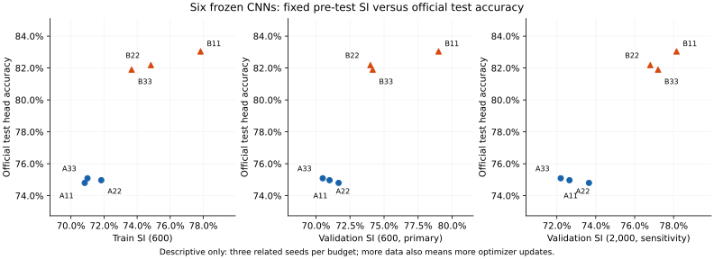
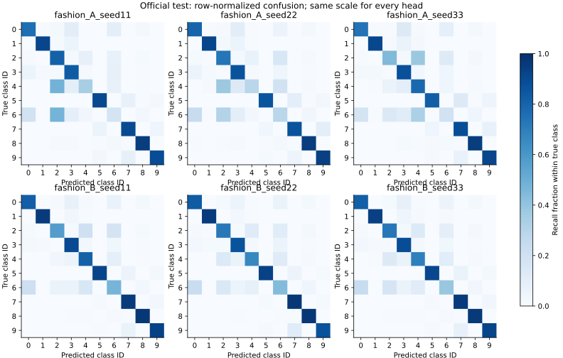

# Fashion-MNIST — frozen final evaluation

Completed 2026-10-21T13:45:46.298696+00:00. All 24 predeclared readouts were evaluated on the official 10,000-image test set after exact reproduction of their saved validation predictions. This test is now inspected. No neural refit, checkpoint selection, test SI or post-test tuning was performed.

## Fixed design

One 9,802-parameter CNN, three paired initialization seeds (11/22/33), 30 epochs, A=3,000 and B=12,000 nested training images. Validation is 6,000 held-out original training images. Fixed SI600 train and validation scores are primary predictors; validation SI2000 is a declared sensitivity view. B has 2,820 updates versus A's 720, so its intervention combines data quantity and training exposure. The comparison does not isolate a matched-compute data effect.

The [pre-test plan](../FINAL_EVALUATION_PLAN.md), [training freeze](../TRAINING_FREEZE.json), [validation report](../experiment/VALIDATION_REPORT.md), [validation gate](validation_gate.json), [results](final_results.json), [all predictions](predictions.csv) and [saved-result verification](VERIFICATION.json) preserve the evidence. Training/validation artifacts retain their historical pre-test status.

## All six classifier heads

| Budget | Seed | Validation accuracy | Test accuracy | Test macro-F1 | Errors | Train SI600 | Validation SI600 | Validation SI2000 |
|---|---:|---:|---:|---:|---:|---:|---:|---:|
| A | 11 | 74.97% | 74.80% | 0.7354 | 2520 | 70.83% | 71.67% | 73.65% |
| B | 11 | 83.62% | 83.04% | 0.8268 | 1696 | 77.83% | 79.00% | 78.15% |
| A | 22 | 75.48% | 74.97% | 0.7380 | 2503 | 71.83% | 71.00% | 72.65% |
| B | 22 | 82.87% | 82.18% | 0.8180 | 1782 | 74.83% | 74.00% | 76.80% |
| A | 33 | 75.88% | 75.09% | 0.7387 | 2491 | 71.00% | 70.50% | 72.20% |
| B | 33 | 82.97% | 81.90% | 0.8140 | 1810 | 73.67% | 74.17% | 77.20% |

| Budget | Mean test accuracy | Sample SD (percentage points) | Mean test macro-F1 |
|---|---:|---:|---:|
| A | 74.95% | 0.146 | 0.7374 |
| B | 82.37% | 0.594 | 0.8196 |

Seed SD is descriptive, not a confidence interval. Paired B minus A differences (percentage points): seed 11: +8.240, seed 22: +7.210, seed 33: +6.810.

## All six input baselines and twelve frozen-feature probes

| Readout | Test accuracy | Macro-F1 | Fit/prediction warnings |
|---|---:|---:|---:|
| fashion_A_seed11__linear_probe | 80.25% | 0.8001 | 1 |
| fashion_A_seed11__cross_split_1nn_probe | 73.92% | 0.7404 | 0 |
| fashion_B_seed11__linear_probe | 84.61% | 0.8447 | 1 |
| fashion_B_seed11__cross_split_1nn_probe | 79.85% | 0.7994 | 0 |
| fashion_A_seed22__linear_probe | 79.90% | 0.7962 | 1 |
| fashion_A_seed22__cross_split_1nn_probe | 73.49% | 0.7363 | 0 |
| fashion_B_seed22__linear_probe | 83.90% | 0.8381 | 1 |
| fashion_B_seed22__cross_split_1nn_probe | 79.58% | 0.7970 | 0 |
| fashion_A_seed33__linear_probe | 78.41% | 0.7803 | 1 |
| fashion_A_seed33__cross_split_1nn_probe | 72.13% | 0.7232 | 0 |
| fashion_B_seed33__linear_probe | 83.29% | 0.8317 | 1 |
| fashion_B_seed33__cross_split_1nn_probe | 78.34% | 0.7854 | 0 |
| fashion_A__input_majority | 10.00% | 0.0182 | 0 |
| fashion_A__input_logistic_regression | 81.14% | 0.8115 | 0 |
| fashion_A__input_euclidean_1nn | 77.52% | 0.7767 | 0 |
| fashion_B__input_majority | 10.00% | 0.0182 | 0 |
| fashion_B__input_logistic_regression | 82.11% | 0.8204 | 0 |
| fashion_B__input_euclidean_1nn | 81.24% | 0.8137 | 0 |

All six linear probes reached max_iter=1000 during training-only refitting, matching validation warnings. They are optimization-budget-limited probes; they are not fully optimized estimates of linear separability. No iterations, normalization or C values were adjusted. Complete warning text, parameters, iterations and timings are in the results and readout files. Input logistic regression had no convergence warning.

## Declared rank agreement with head test accuracy

| Saved predictor | All six models rho | Within A rho | Within B rho |
|---|---:|---:|---:|
| train_si600 | 0.943 | 0.500 | 1.000 |
| validation_si600 | 0.714 | -1.000 | 0.500 |
| validation_accuracy | 0.943 | 1.000 | 0.500 |
| negative_validation_cross_entropy | 0.771 | -1.000 | 1.000 |
| training_budget | 0.878 | undefined (constant) | undefined (constant) |
| validation_si2000 | 0.714 | -1.000 | 0.500 |

Rho uses average ranks for ties. Pair counts are retained in JSON. There are only six related models, three seeds within each budget, one dataset, one architecture and one split. Between-budget separation can dominate six-model agreement. No p-values, significance, universal predictor ranking or independent-model claim is justified. SI is supervised; validation SI also uses validation labels. Larger SI subsets change neighbourhood geometry and do not create independent experiments. Optdigits and Fashion-MNIST are reported separately.

In this test, all three A heads fall below the A input logistic baseline (81.14%); two of three B heads exceed the B input logistic baseline (82.11%). Higher aggregate SI agreement does not imply a universal ordering: within A, validation SI600 and SI2000 decrease as head test accuracy increases (rho=-1 across only three seeds). Train SI600 and ordinary validation accuracy both have six-model rho=0.943. These observations do not establish an advantage for SI as a transferable performance predictor.

## Per-class recall of each head

| Run | T-shirt/top | Trouser | Pullover | Dress | Coat | Sandal | Shirt | Sneaker | Bag | Ankle boot |
|---|---:|---:|---:|---:|---:|---:|---:|---:|---:|---:|
| fashion_A_seed11 | 75.80% | 91.70% | 81.20% | 83.50% | 34.10% | 90.30% | 17.70% | 90.00% | 94.90% | 88.80% |
| fashion_B_seed11 | 81.80% | 95.60% | 57.40% | 90.00% | 81.20% | 92.10% | 47.10% | 95.50% | 96.90% | 92.80% |
| fashion_A_seed22 | 80.00% | 91.40% | 73.10% | 86.40% | 28.90% | 86.10% | 28.80% | 86.70% | 94.60% | 93.70% |
| fashion_B_seed22 | 83.20% | 95.70% | 71.90% | 86.70% | 66.40% | 92.80% | 43.90% | 97.20% | 97.20% | 86.80% |
| fashion_A_seed33 | 73.90% | 90.80% | 44.80% | 87.80% | 78.00% | 82.10% | 18.90% | 88.40% | 94.60% | 91.60% |
| fashion_B_seed33 | 82.00% | 93.70% | 72.50% | 88.80% | 69.20% | 90.80% | 38.60% | 95.60% | 95.90% | 91.90% |

Complete confusion matrices and per-class precision/F1/support for all 24 readouts are retained in JSON.

Fixed error gallery (not included in this publication snapshot)

The error gallery is the first twelve A/seed-11 errors in ascending test row order, as declared before evaluation. It is diagnostic and is not a random sample or a basis for model selection.

## Execution and limitations

CPU, one thread. Validation reproduction gate: 75.828 s; total evaluation after imports: 117.797 s. No neural training is included. Runtime includes training-only classifier refits, feature extraction, test prediction and artifact export. The existing environment passed 72 unit tests, including four new final-evaluation guards. No fresh-environment installation was tested.

Saved predictions reproduce classification metrics for all 24 readouts, all group/paired summaries and all 18 rank comparisons without fitting or neural inference. Cross-entropy cannot be reconstructed from class predictions alone; it was computed from frozen-model logits by the evaluator. Verification is a software/artifact consistency check, not an independent replication. The portable [readout manifest](readout_manifest.json) permits exact reconstruction of the per-readout execution JSON from the full results and shared CSV; duplicate IDs/truth arrays are factored out. Original per-readout execution files remain in the local C: cache.

Official file hashes and format were checked. Exact duplicates/conflicts were absent in the prior 70,000-image audit; near duplicates and product/subject independence remain unverified. Benchmark limitations and limited seed count restrict transfer claims. Any later model or method change informed by these results is exploratory and needs new confirmation evidence.

No Git initialization, staging, commit, push or publication occurred in this milestone.
